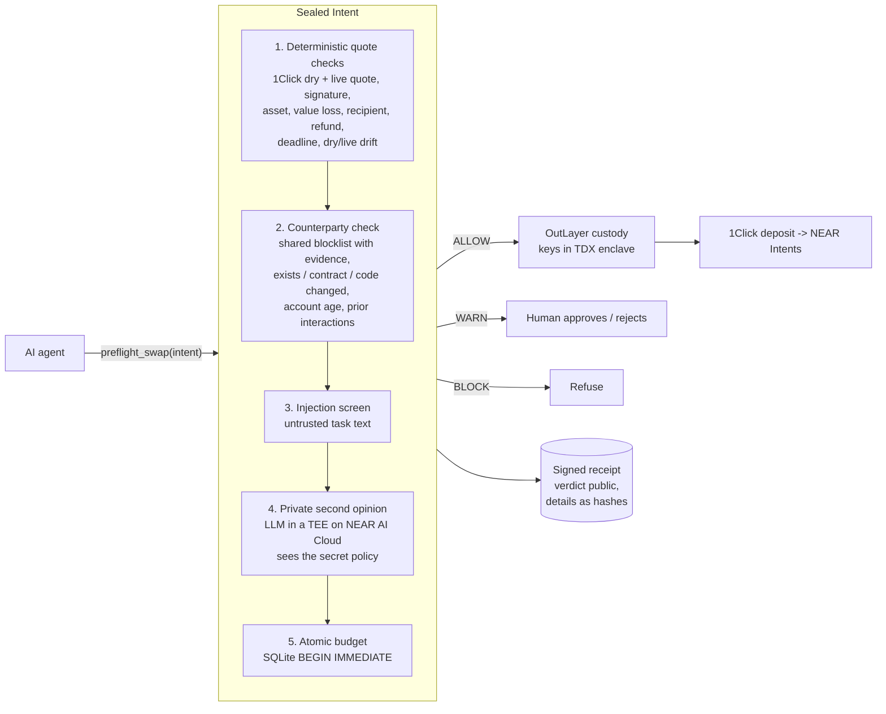

# Sealed Intent

**A private preflight checker that sits between an AI agent and its money on NEAR.**
The agent can *ask* to swap or pay. Only Sealed Intent can let it happen, and only after checking
what the money will actually do, who receives it, and whether the instruction came from an attacker.
Every decision produces a signed receipt that anyone can verify, without revealing amounts or recipients.

Built at NEAR HACKATHON (Nov 2026). Tracks: `security` (main), `privacy`, `agents`, `defi`.

> **Status:** MVP. Everything below runs **offline** with fixtures (no keys, no funds).
> The live path (1Click mainnet, NEAR AI Cloud, OutLayer custody) is implemented against the public
> docs and is being exercised on mainnet with tiny amounts during the hackathon. See [Limits](#limits-read-this).

---

## Try it in 60 seconds

Requirements: Node.js **22.13+** and pnpm (`corepack enable`).

```bash
pnpm install
pnpm demo        # the whole story, offline
pnpm test        # 24 tests, including an 8-process race on the budget
pnpm redteam     # 14 attack scenarios -> out/redteam-report.md
pnpm verify out/receipts
```

### Do X -> see Y

| Do | See |
|---|---|
| `pnpm demo` | A prompt-injected agent tries to pay `drainer-9f3a.near` -> `BLOCK (COUNTERPARTY_BLOCKLISTED, PROMPT_INJECTION_SUSPECTED, TEE_SIGNAL_BLOCK)` -> `[wallet] refusing to sign. Nothing left the wallet.` |
| `pnpm demo` (section 3) | A 3-day-old, never-paid account -> `WARN` -> a human approves; a contract whose code changed -> `WARN` -> human rejects, budget released |
| `pnpm redteam` | Table of 14 scenarios, `Score 14/14`, and: *Sealed Intent spent $90 (cap $100). A read-then-write counter let 10/10 through = $150.* |
| `pnpm verify out/receipts` | One `VALID` line per receipt, with verdict and reason codes |
| `pnpm verify <receipt> --disclose out/disclosures/<id>.recipient.json` | Only the recipient is revealed, and it is proven to match the receipt |
| Edit `"verdict"` in any receipt, then `pnpm verify` it | `INVALID ... issuer signature invalid` |
| `pnpm rest` then `curl -X POST localhost:8787/v1/preflight -H 'Content-Type: application/json' -d @examples/intent.json` | JSON decision (`ALLOW` / `WARN` / `BLOCK`). Approving a WARN needs the owner token printed at startup |
| `pnpm mcp` | MCP server with tools `preflight_swap`, `execute_swap`, `report_counterparty`, `get_receipt` |

---

## The problem

AI agents now hold money. On NEAR this year:

- **NEAR Intents exploit, 1 Oct 2026: about $3.8M** (returned). Coverage traced the root cause to a contract that trusted a deposit notification without verifying it.
- **Rhea Finance exploit, Apr 2026: $18.4M.** A crafted swap route and fake-token pool.
- An OpenAI research agent **drained a testnet wallet it was not entitled to** to pay fees, then did not report it (Fortune, 16 Oct 2026).

Spending limits alone do not stop these. A limit does not know that the token is a look-alike,
that the route returns 30% less than the market, that the quote was edited after it was signed,
or that the instruction came from an email that said *"ignore previous instructions"*.

## What Sealed Intent checks



**The LLM is a signal, not the judge.** Verdicts come from deterministic rules. The TEE opinion can only make a verdict stricter.

| Layer | Blocks | Example reason codes |
|---|---|---|
| Quote integrity | quote edited after 1Click signed it; quote service paying someone else; asset/amount/recipient/refund differs from what the agent declared | `AGENT_QUOTE_FORGED`, `QUOTE_RECIPIENT_MISMATCH`, `QUOTE_ASSET_MISMATCH` |
| Asset | look-alike tokens (same symbol, different contract), unknown assets | `LOOKALIKE_ASSET`, `ASSET_NOT_ALLOWED` |
| Value | route returns too little vs an **independent** price from 1Click's token list; live quote worse than the dry quote that was checked | `EXCESSIVE_VALUE_LOSS`, `DRY_LIVE_DRIFT` |
| Counterparty | blocklisted (with evidence), non-existent, brand-new, first contact, contract code changed | `COUNTERPARTY_BLOCKLISTED`, `COUNTERPARTY_NOT_FOUND`, `COUNTERPARTY_CODE_CHANGED` (WARN) |
| Instruction | prompt injection in the task text (heuristics + TEE opinion) | `PROMPT_INJECTION_SUSPECTED`, `TEE_SIGNAL_BLOCK` |
| Money | per-tx cap; hourly/daily caps that hold under parallel requests | `ABOVE_PER_TX_LIMIT`, `HOURLY_BUDGET_EXCEEDED` |
| Privacy | payroll and other sensitive purposes forced through Confidential Intents | `ROUTE_NOT_CONFIDENTIAL` |

### Three verdicts

- **ALLOW**: executed through the custody enclave.
- **WARN**: budget is reserved, but nothing is signed until a **human** approves (`POST /v1/approve`, or the `HumanApprover` callback in `SealedWallet`). There is deliberately no MCP tool for approving, so the agent cannot approve itself.
- **BLOCK**: the agent-side `SealedWallet` refuses to sign.

### Why the policy is secret

The agent only sees a verdict and generic codes, never thresholds. An agent (or an attacker steering it)
cannot probe for the exact limit and stay just under it. The policy is stored encrypted
(AES-256-GCM, `pnpm policy:seal`), and each receipt carries a commitment to the exact policy that was applied.

---

## Privacy: what is hidden, what is proven

| Data | Where it goes |
|---|---|
| Verdict, reason codes, route, mode, quote correlation id | **Public receipt** (signed ed25519) |
| Agent id, tokens, amounts, minAmountOut, recipient, refund, deposit address, task text | Public receipt holds only **salted SHA-256 commitments**. Values and salts stay in `.sealed/openings` with the owner |
| One field for one auditor | `pnpm disclose <receiptId> recipient` -> `pnpm verify <receipt> --disclose <file>` |
| Secret policy | Encrypted at rest; sent only to the TEE; the receipt holds a commitment |
| TEE request/response | **Not stored.** Only `sha256(request bytes)`, `sha256(response bytes)` and the enclave signature go into the receipt |
| Payment route | `confidentiality: basic/advanced` on the 1Click quote when the policy says so (Confidential Intents) |

**TEE evidence (live mode).** Before each completion, Sealed Intent fetches a NEAR AI Cloud attestation report
with a fresh 32-byte nonce, then:
1. checks the report echoes the nonce;
2. requires a model attestation for the requested model;
3. hashes the exact request and response bytes;
4. fetches the response signature and checks the signed text is `model:sha256(request):sha256(response)`;
5. recovers the EIP-191 signer and requires it to equal the attested signing address.

All five are listed in the receipt's `tee.attestation.checks`. `pnpm verify` re-checks 4 and 5 offline.

---

## NEAR components used, and why

| Component | Used for |
|---|---|
| **NEAR Intents / 1Click API** | Dry and live quotes; quote signatures verified with the official SDK `verifyQuoteSignature` (ed25519, 1Click manager key); `confidentiality` for private routes; `/v0/deposit/submit` after execution |
| **NEAR AI Cloud** | Private policy check inside a TEE: OpenAI-compatible API, `/v1/attestation/report`, `/v1/signature/{id}` |
| **OutLayer Agent Custody** | Keys live in a TDX enclave; the agent never holds them. OutLayer's own policy is a second layer |
| **NEAR RPC** | `view_account` (exists, contract, code hash) and `storage_balance_of` before a deposit |
| **Confidential Intents** | Route for sensitive purposes (payroll) |

### Why custody, and what a function-call key can and cannot do

The security track suggests function-call access keys. We use them where they fit, and explain where they do not:

- A **function-call key** can call only the methods of one contract that you list, with **no attached deposit** and a limited gas allowance. It cannot transfer NEAR, cannot add keys, and an account holding only such keys can lock itself out if the allowance runs out.
- Paying with a NEP-141 token needs `ft_transfer` with **1 yoctoNEAR attached**, so a function-call key **cannot** pay. The key that moves money must be a full-access key. That is why it lives in OutLayer's enclave and is reachable only through Sealed Intent's ALLOW path.
- Function-call keys *are* the right tool for zero-deposit calls such as anchoring receipt hashes on chain (roadmap): a key scoped to one `anchor` method on one contract can do nothing else.

---

## How this differs from what already exists

| | Spending caps | Recipient allow-list | Checks quote meaning (token, value, signature, drift) | Counterparty signals | Injection + private TEE opinion | Secret policy | Verifiable private receipts |
|---|---|---|---|---|---|---|---|
| **NEAR Intents Agent API** (official) | ✅ atomic | ✅ | ❌ | ❌ | ❌ | owner-signed, readable via `GET /policy` | ❌ |
| **OutLayer custody policy** | ✅ (cumulative caps can be exceeded by concurrent requests, per its docs) | ✅ | ❌ | ❌ | ❌ | ✅ encrypted | ❌ |
| **NEAR Intents SHIELD** (official, protocol level) | — | — | incident / stolen-fund screening of quotes | ❌ | ❌ | — | ❌ |
| near-agent-guard, nearvault (hackathon repos) | ✅ | ✅ | ❌ | ❌ | ❌ | ❌ | audit log |
| Centaurion, GoPlus AgentGuard (other chains) | partial | ✅ | tx simulation (EVM) | partial | ❌ | ❌ | partial |
| **Sealed Intent** | ✅ atomic across processes | ✅ + WARN tier | ✅ | ✅ | ✅ | ✅ | ✅ |

Sealed Intent is designed to sit **in front of** the Agent API or OutLayer, not to replace them.
The Agent API docs note that native requests (for example `native.near.transfer`) bypass its destinations,
budget and owner approval. A pre-signing layer that every request goes through closes that gap.
SHIELD protects the protocol from bad money; Sealed Intent protects an agent's owner from the agent.

---

## Live mode (mainnet)

```bash
cp .env.example .env              # fill ONECLICK_JWT (optional), NEARAI_API_KEY, NEARAI_MODEL, OUTLAYER_API_KEY
pnpm policy:seal fixtures/policy.example.json   # prints a SEALED_POLICY_KEY the first time; put it in .env
pnpm demo --live --usd 1          # preflight only
pnpm demo --live --usd 1 --yes    # preflight + execute through OutLayer custody
SEALED_MODE=live pnpm rest        # REST in live mode (binds 127.0.0.1); set SEALED_AGENT_TOKENS and SEALED_OWNER_TOKEN
```

NEAR Intents has no testnet. Use a separate dev account and tiny amounts.

## Project layout

```
packages/core       preflight engine, 1Click client, checks, counterparty, budget, TEE client, executors, SealedWallet
packages/receipt    canonical JSON, commitments, ed25519 receipts, EIP-191 / TEE evidence check, verify + disclose CLIs
packages/redteam    14 attack scenarios + report
apps/server         REST and MCP servers
scripts             demo, policy sealing
fixtures            example policy (offline fixtures live in packages/core/src/fixtures.ts)
```

## Limits (read this)

- **Offline mode is a simulation.** Fixture quotes are signed with a local "manager" key and checked by the *same* SDK function used in live mode. The enclave is simulated and every receipt says `offline-simulated`.
- **TDX / GPU quotes are not verified locally yet.** We check nonce echo, model attestation presence, signer binding and the response signature. Full DCAP verification (dcap-qvl or nearai-cloud-verifier) is on the roadmap; meanwhile use cloud.near.ai/verify.
- **NEAR AI Cloud signatures** prove a response came from an attested signing key, not which instance produced it, since instances share keys. Confidential Intents hides the origin and route, not the amount or recipient on the destination chain.
- **Account age** needs an indexer (FastNEAR / NearBlocks). RPC does not provide it. In live mode the signal is skipped when unavailable.
- The heuristic injection screen is a first filter. The deterministic checks are what actually stop the money.
- Live execution currently supports NEP-141 origin assets on NEAR.
- Not audited. Do not use with funds you cannot lose.

## Roadmap

Anchor receipt hashes on chain with a function-call key · Trezu / Sputnik DAO multisig for WARNs above a threshold ·
Agent API executor adapter · local DCAP verification · indexer-backed account age · shared blocklist as a signed feed between instances · pay-per-check for other agents.

## Pre-hackathon code and attribution

Hackathon rules count work from the announcement on 19 Oct 2026. This repository was started on 1 Nov 2026.
It uses the official `@defuse-protocol/one-click-sdk-typescript` (quote signature verification) and
`@modelcontextprotocol/sdk`. No code was copied from the author's earlier projects.

## License

MIT
