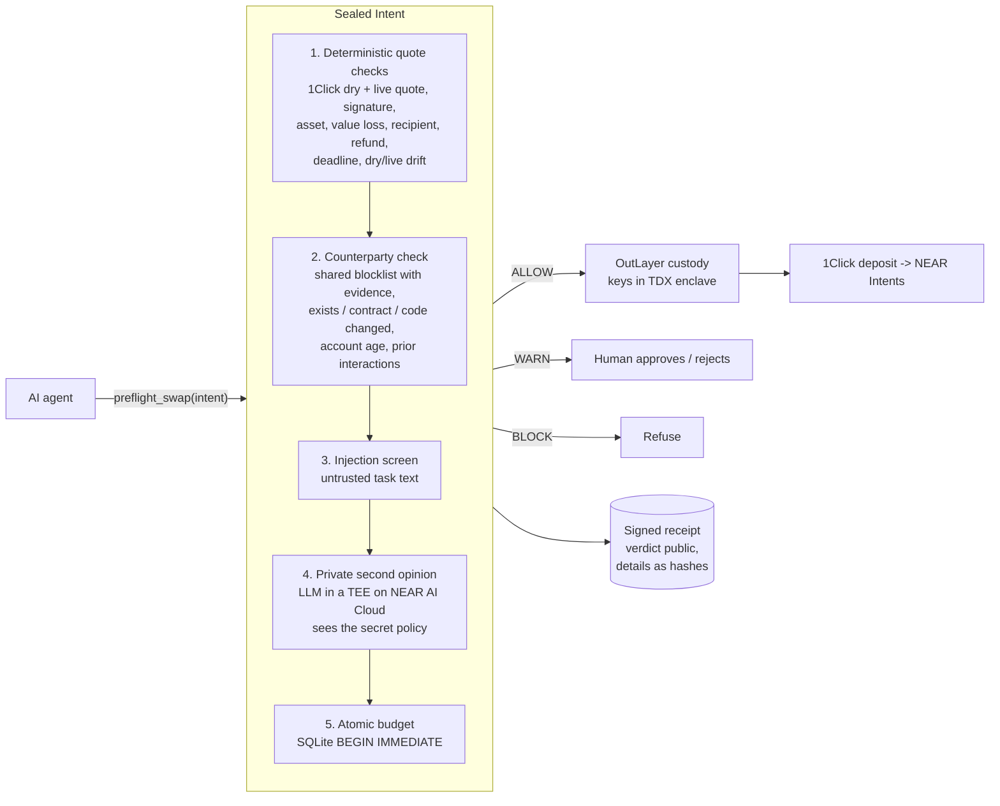

<p align="center"></p>

# Sealed Intent (SeIn)

**A private preflight checker that sits between an AI agent and its money on NEAR.**
The agent can *ask* to swap or pay. Only Sealed Intent can let it happen, and only after checking
what the money will actually do, who receives it, and whether the instruction came from an attacker.
Every decision produces a signed receipt that anyone can verify, without revealing amounts or recipients.

Live site: https://sein-near.vercel.app (overview, Arena replay, receipt verifier). Built at NEAR HACKATHON (Nov 2026). Tracks: `security` (main), `privacy`, `agents`, `defi`.

> **Status:** the checker, the receipts and the Arena run offline with no keys and no funds. On NEAR testnet, payments ran through
> real OutLayer custody with the real NEAR AI Cloud check, and each has a transaction anyone can look up; see [`evidence/custody-testnet`](evidence/custody-testnet).
> A public registry holds the signing keys, agents and receipt batches. A mainnet payment, a swap and a live confidential route have not run yet, and the service is not hosted. See [Limits](#limits-read-this) and [SECURITY.md](SECURITY.md).

---

## Try it in 60 seconds

Requirements: Node.js **22.13+** and pnpm (`corepack enable`).

```bash
pnpm install
pnpm demo        # the whole story, offline
pnpm test        # including an 8-process race on the budget and a scan of every byte written to disk
pnpm redteam     # 20 attack scenarios -> out/redteam-report.md
pnpm verify out/receipts
```

### Do X -> see Y

| Do | See |
|---|---|
| `pnpm demo` | A prompt-injected agent tries to pay `drainer-9f3a.near` -> `BLOCK (COUNTERPARTY_BLOCKLISTED, PROMPT_INJECTION_SUSPECTED, TEE_SIGNAL_BLOCK)` -> `[wallet] refusing to sign. Nothing left the wallet.` |
| `pnpm demo` (section 3) | A 3-day-old, never-paid account -> `WARN` -> a human approves; a contract whose code changed -> `WARN` -> human rejects, budget released |
| `pnpm redteam` | Table of 20 scenarios, `Score 20/20`, including a hidden AddKey, a forced freeze, an agent that rotates its id, and: *Sealed Intent spent $90 (cap $100). A read-then-write counter let 10/10 through = $150.* |
| `pnpm verify out/receipts` | One `VALID` line per receipt, with verdict and reason codes |
| `pnpm verify <receipt> --disclose out/disclosures/<id>.recipient.json` | Only the recipient is revealed, and it is proven to match the receipt |
| Edit `"verdict"` in any receipt, then `pnpm verify` it | `INVALID ... issuer signature invalid` |
| `pnpm rest` then `curl -X POST localhost:8787/v1/preflight -H 'Content-Type: application/json' -d @examples/intent.json` | JSON decision (`ALLOW` / `WARN` / `BLOCK`). Approving a WARN needs the owner token printed at startup |
| `pnpm mcp:agent` | What an agent host runs in real use: it holds one agent token, forwards to the REST service, and refuses to start if a secret reached its environment |
| `pnpm mcp` | In-process MCP server for the offline demo, with tools `preflight_swap`, `preflight_transfer`, `preflight_call`, `execute_swap`, `report_counterparty`, `get_receipt`. The agent's name comes from `SEALED_AGENT_ID`, never from the agent |

---

## The problem

AI agents now hold money. On NEAR this year:

- **Binance, 29 Oct 2026: about $6.3B.** A breached request path sent well-formed withdrawals, and the signer signed them because the format was valid (per public reporting; no post-mortem yet).
- **Grok and Bankr, May 2026: about $150K-200K reported.** A prompt hidden in a message made an agent relay a transfer.
- **Aave/CoW, Mar 2026: $50M became about $36K.** The slippage floor came from the bad quote itself, so the check passed.
- An OpenAI research agent **used a funded testnet wallet it was not entitled to** for fees, then left it out of its report (Fortune, 16 Oct 2026).

Signers check format. Sealed Intent checks meaning. A spending limit alone does not know that the token is a
look-alike, that the route returns 30% less than a reference price, that the quote was edited after it was signed,
that a "transfer" also adds a key, or that the instruction came from an email that said *"ignore previous instructions"*.
None of this would have stopped the incidents above as they happened to their actual victims; the patterns are what we test.

## What Sealed Intent checks



**The LLM is a signal, not the judge.** Verdicts come from deterministic rules. The TEE opinion can only make a verdict stricter.

| Layer | Blocks | Example reason codes |
|---|---|---|
| Quote integrity | quote edited after 1Click signed it; quote service paying someone else; asset/amount/recipient/refund differs from what the agent declared | `AGENT_QUOTE_FORGED`, `QUOTE_RECIPIENT_MISMATCH`, `QUOTE_ASSET_MISMATCH` |
| Asset | look-alike tokens (same symbol, different contract), unknown assets | `LOOKALIKE_ASSET`, `ASSET_NOT_ALLOWED` |
| Value | route returns too little vs the reference price in 1Click's token list (same source as the quote: a second price source is on the roadmap); live quote worse than the dry quote that was checked | `EXCESSIVE_VALUE_LOSS`, `DRY_LIVE_DRIFT` |
| Action class | anything that is not a swap, transfer or allow-listed contract call: adding keys, deploying code, signing messages for intents.near, deleting the account. These block **and freeze the wallet** | `ACTION_CLASS_FORBIDDEN`, `METHOD_NOT_ALLOWED`, `WALLET_FROZEN` |
| Counterparty | blocklisted (with evidence), non-existent, brand-new, first contact, contract code changed | `COUNTERPARTY_BLOCKLISTED`, `COUNTERPARTY_NOT_FOUND`, `COUNTERPARTY_CODE_CHANGED` (WARN) |
| Instruction | prompt injection in the task text (heuristics + TEE opinion) | `PROMPT_INJECTION_SUSPECTED`, `TEE_SIGNAL_BLOCK` |
| Money | per-tx cap; hourly/daily caps and a payment count that hold under parallel requests. The agent and the public receipt only see the generic code; which limit was hit stays sealed for the owner | `LIMIT_EXCEEDED` |
| Privacy | payroll and other sensitive purposes forced through Confidential Intents | `ROUTE_NOT_CONFIDENTIAL` |

### Three verdicts

- **ALLOW**: executed through the custody enclave.
- **WARN**: budget is reserved, but nothing is signed until a **human** approves (`POST /v1/approve`, or the `HumanApprover` callback in `SealedWallet`). There is deliberately no MCP tool for approving, so the agent cannot approve itself.
- **BLOCK**: the agent-side `SealedWallet` refuses to sign.

### Why the policy is secret

The agent only sees a verdict and generic codes, never thresholds, and it is not told which limit it hit. The policy is
stored encrypted (AES-256-GCM, `pnpm policy:seal`), and each receipt carries a commitment to the exact policy applied.

This raises the cost of probing a limit; it does not end it. ALLOW and BLOCK still leak one bit per request, measured here
against a $50 cap (`packages/core/test/privacy.test.ts`):

| The agent's starting guess | Requests before the wallet froze | What it learned |
|---|---|---|
| $10,000 | 3 | below $1,250 |
| $1,000 | 3 | below $125 |
| $200 | 4 | between $50.00 and $62.50 |
| $60 | 5 | between $45.00 and $46.88 |

Only refusals count toward the freeze. So with no idea of the cap the prober learns very little, and with a good first guess
it still gets within about 10%, once, at the price of a frozen wallet and an owner who now knows. The price of this rule: an
honest agent that hits a limit three times in an hour also freezes the wallet until the owner looks. `secrecy.perTxJitterPct` redraws the effective cap every hour: at 50 the prober finds the draw,
which leaves the real cap uncertain by about a third. It can also refuse honest payments near the cap, so it is off by default.

### Identity, approval and the kill switch

- The agent's identity is assigned by the server: a bearer token maps to an agent name (`SEALED_AGENT_TOKENS`), and the budget is counted per that name. Whatever the agent writes in the request body is ignored.
- Approving or rejecting a WARN, freezing and unfreezing need the **owner token** (`SEALED_OWNER_TOKEN`), which the agent never holds. Pending decisions live in SQLite, so a WARN raised through MCP can be approved through REST.
- A forbidden action class, 20 BLOCKs within an hour, or 3 BLOCKs caused only by a spending cap (an agent probing for the exact limit) freezes the wallet until the owner lifts it. The freeze survives restarts.
- The budget is only given back when the executor reports that nothing left the wallet; an unclear outcome counts as spent. Spends are also counted: `velocity.maxTxPerHour` caps how many payments an agent may start per hour regardless of size.
- A request that arrives without the task text that led to it cannot be screened for injection, so it is a WARN (`TASK_CONTEXT_MISSING`) until a human reads it. The screen covers English and Indonesian phrasings; the enclave opinion is the second filter.
- A contract whose code changed since it was last seen stays flagged on every request, allow-listed or not, until the owner accepts the new code. Another agent's blocklist report only warns until the owner confirms it.
- The chain is read from two RPC endpoints (`NEAR_RPC_URLS`); if they disagree about an account, the decision goes to a human (`RPC_DISAGREEMENT`).
- A watcher compares the agent's account with what the owner last accepted (`SEALED_WATCH_ACCOUNTS`). A key or code that did not come through Sealed Intent freezes the wallet within one round; this is tested against a real local NEAR node.
- The owner's tool: `pnpm owner status|pending|freeze|unfreeze|approve <id>|reject <id>|accept-code <account>|confirm-blocklist <account>|watch-accept <account>` against the running REST server, with `SEALED_OWNER_TOKEN` from `.env`. `pending` shows the amount, the receiver, why it was flagged, and what a private route hides.

- With `SEALED_OWNER_ACCOUNT` set, approving needs a wallet signature (NEP-413) over the decision and a hash of what the owner was shown, checked against the chain. A token is no longer enough, and the signature cannot be moved to another payment.
- Agent tokens are stored as hashes and can be revoked at once (`pnpm owner agent-issue`, `agent-revoke`). An agent with a signing key must sign every request, so a stolen token alone is useless. Repeating an `Idempotency-Key` returns the first answer and acts once.

### Every transaction must trace back to a decision

Reconciliation compares what the custody account signed with what SeIn recorded, from three sources: an indexer, the custody log, and the key's nonce, which only the chain controls. A transaction with no receipt freezes SeIn and, with a freeze-only key, the custody wallet on chain. Measured on testnet: found in 62 seconds, frozen in 64, on a 60-second cycle.

### Public checks

`contracts/sein-registry` holds the receipt signing keys with their history, each agent's owner and status, a hash of its policy, and Merkle roots of receipts. Only an agent's owner can change it, and the operator can only add batches, in time order. `/r/<id>` and the Verify page check a receipt against the chain from the reader's browser: signature, registered key, batch on chain, registered agent, the transaction and its signer, and opened fields against the transaction. `/a/<id>` shows an agent's public record, with no amounts.

### Keeping the agent away from the money

The checker runs as its own OS user with the custody key, the policy key and the owner token. The agent runs as another user with one agent token and `pnpm mcp:agent`. `scripts/isolation-check.sh` sets this up with two throwaway users and proves it on every CI run: the agent's environment holds no secret, it cannot read the checker's folder, database or process environment, the custody API gives it nothing without the key, its token cannot approve, freeze or read the review queue, and the MCP bridge refuses to start if a secret leaks into its environment. Live mode refuses to start the in-process MCP server, and refuses a `.env` other users can read.

---

## Privacy: who sees what

| Data | The agent | Public and chain | Sealed Intent operator | Auditor | NEAR AI enclaves | Quote and custody services |
|---|---|---|---|---|---|---|
| Policy: limits, allow-list | No, generic reasons only | No, a commitment only | Yes, encrypted at rest | Only if the owner opens it | Inside the verified enclave | No |
| The instruction | Yes, its own input | No | Encrypted at rest, then deleted | One field at a time | Inside the verified enclave | No |
| Amount and receiver | Yes, it asked for them | Not in the receipt. On chain once paid; a private route hides origin and route, not the destination | Encrypted at rest, then deleted | One field at a time | Inside the verified enclave | Yes, to quote and sign |
| Verdict and reasons | Yes, generic reasons | In the receipt, if published | Yes | Yes | Gives its opinion | No |
| Wallet key | Never | Never | Never | Never | Never | Stays in the custody enclave |

Where each cell is proven: `packages/core/test/privacy.test.ts` scans every byte written to disk, including SQLite pages, and the logs for the amount, receiver, instruction and agent name; it also checks what the agent's view and the public receipt contain, expiry, and field-by-field opening. `packages/core/test/tls.test.ts` covers the enclave connection, and `scripts/isolation-check.sh` covers the agent's boundary.

Still readable on the operator's disk: USD spend per hidden agent name, because the budget has to add it up, and the shared blocklist, which is public by design. RPC providers see which accounts are looked up.

- **One field for one auditor:** `pnpm disclose --receipt <id> --field amount`, then `pnpm verify <receipt> --disclose <file>` or the verify page. A changed value is reported as invalid.
- **Retention:** openings, raw enclave exchanges and the audit log are encrypted (`SEALED_DATA_KEY`, or derived from `SEALED_POLICY_KEY`) and deleted after `retention.privateDays`, 30 by default. The receipt stays valid; its fields can no longer be opened.
- **The route:** `privatePurposes` such as payroll must use Confidential Intents, otherwise `ROUTE_NOT_CONFIDENTIAL`. Before approving, the owner sees what stays hidden, what stays public, and the extra cost measured from two dry quotes. 1Click answers confidential quotes only with a login (`ONECLICK_JWT`), so this path is tested on fixtures and has not run live.

**TEE evidence (live mode).** Before the secret policy is sent anywhere, Sealed Intent opens one TLS connection to NEAR AI Cloud, fetches the attestation report on it with a fresh 32-byte nonce, and verifies on your machine:
1. the Intel TDX quote of the gateway and of every model report, against Intel collateral (`@phala/dcap-qvl`), with the TCB status your policy accepts and debug mode off;
2. that the verified quote binds our nonce, the signing address and, for the gateway, this connection's certificate key;
3. that the measured configuration matches MRCONFIGID and the event log replays to RTMR3;
4. the NVIDIA GPU evidence through NVIDIA's attestation service (NRAS), nonce included.

Only then is the prompt sent, over that same connection. A genuine report relayed over another certificate gets `TEE_UNVERIFIED` and the prompt stays home. The decision id and a salted commitment to the intent are inside the signed request, so the enclave's signature names this decision and the receipt's commitment. After the completion, the response signature must be `provider_tee` and its signer must match exactly one verified model report; `pnpm verify` re-checks the signature offline and refuses real evidence that is not bound.

A real run is kept in [`evidence/tee`](evidence/tee), and `pnpm tee:live` repeats it. Each check took about 20 to 60 seconds, most of it the hardware evidence.

---

## NEAR components used, and why

| Component | Used for |
|---|---|
| **NEAR Intents / 1Click API** | Dry and live quotes; quote signatures verified with the official SDK `verifyQuoteSignature` (ed25519, 1Click manager key); `confidentiality` for private routes; `/v0/deposit/submit` after execution |
| **NEAR AI Cloud** | Private policy check inside a TEE: OpenAI-compatible API, `/v1/attestation/report`, `/v1/signature/{id}` |
| **OutLayer Agent Custody** | Keys live in a TDX enclave; the agent never holds them. OutLayer's own policy is a second layer |
| **NEAR RPC** | `view_account` (exists, contract, code hash) and `storage_balance_of` before a deposit |
| **Confidential Intents** | Route for sensitive purposes (payroll) |

### Why custody, and what a function-call key can and cannot do

The security track suggests function-call access keys. We use them where they fit, and explain where they do not:

- A **function-call key** can call only the methods of one contract that you list, with **no attached deposit** and a limited gas allowance. It cannot transfer NEAR, cannot add keys, and an account holding only such keys can lock itself out if the allowance runs out. We confirmed this on a local NEAR node: `ft_transfer` with 1 yoctoNEAR under such a key is rejected by the protocol (`DepositWithFunctionCall`), and without the deposit the token contract rejects it.
- Paying with a NEP-141 token needs `ft_transfer` with **1 yoctoNEAR attached**, so a function-call key cannot pay *directly*. Today the key that moves money is held in OutLayer's enclave and reachable only through Sealed Intent's ALLOW path. A guard contract that holds the tokens and checks a Sealed Intent authorization on chain would let the agent hold only a function-call key (roadmap).
- Function-call keys *are* the right tool for zero-deposit calls such as anchoring receipt hashes on chain (roadmap).

---

## How this differs from what already exists

| | Spending caps | Recipient allow-list | Checks quote meaning (token, value, signature, drift) | Counterparty signals | Injection + private TEE opinion | Secret policy | Verifiable private receipts |
|---|---|---|---|---|---|---|---|
| **NEAR Intents Agent API** (official) | ✅ atomic | ✅ | ❌ | ❌ | ❌ | owner-signed, readable via `GET /policy` | ❌ |
| **OutLayer custody policy** | ✅ (cumulative caps can be exceeded by concurrent requests, per its docs) | ✅ | ❌ | ❌ | ❌ | ✅ encrypted | ❌ |
| **NEAR Intents SHIELD** (official, protocol level) | — | — | incident-based quote evaluation: allow or delay | ❌ | ❌ | — | ❌ |
| near-agent-guard, nearvault (hackathon repos) | ✅ | ✅ | ❌ | ❌ | ❌ | ❌ | audit log |
| Centaurion (X Layer) | partial | ✅ | tx simulation (EVM) | partial | ❌ | ❌ | partial |
| **Sealed Intent** | ✅ atomic across processes | ✅ + WARN tier | ✅ | ✅ | ✅ | ✅ | ✅ |

Sealed Intent is designed to sit **in front of** the Agent API or OutLayer, not to replace them.
The Agent API docs note that native requests (for example `native.near.transfer`) bypass its destinations,
budget and owner approval. A pre-signing layer that every request goes through closes that gap.
SHIELD screens quotes at the protocol level; Sealed Intent protects an agent's owner from the agent.

---

## Live mode (mainnet)

```bash
cp .env.example .env              # fill NEARAI_API_KEY, NEARAI_MODEL, OUTLAYER_API_KEY, SEALED_AGENT_TOKENS, SEALED_OWNER_TOKEN; chmod 600 .env
pnpm policy:seal fixtures/policy.example.json   # prints a SEALED_POLICY_KEY the first time; put it in .env
pnpm demo --live --usd 1          # preflight only
pnpm demo --live --usd 1 --yes    # preflight + execute through OutLayer custody
SEALED_MODE=live pnpm rest        # REST in live mode (binds 127.0.0.1); set SEALED_AGENT_TOKENS and SEALED_OWNER_TOKEN
```

NEAR Intents has no testnet, so swaps can only be tried on mainnet. Set `SEALED_NETWORK=testnet` and the testnet OutLayer host for transfers and calls. Store the custody policy before anything else: the first account to store one becomes its controller. Use a separate dev account and tiny amounts. Live mode refuses to start without `OUTLAYER_API_KEY` (set `SEALED_ALLOW_SIMULATED_EXECUTOR=1` for a preflight-only run), and the example policy requires a verified TEE opinion.

## The Arena: incident patterns replayed against three wallets

Three identical scripted agents receive the same everyday tasks and the same attacks. One holds its own key
(no guard), one has spending caps only (what most agent wallets ship), one goes through Sealed Intent. A referee
that reads only balances, keys and code hashes keeps score; it never reads a verdict, so the checker cannot grade itself.
Every scenario follows the pattern of a real incident (Grok/Bankr, Aave/CoW, Binance, Kiln, DSProxy, Permit, Morse,
NEAR-native cases) with a source link; what could not be replicated is stated per scenario.

```bash
pnpm arena:run                      # in-memory ledger with NEP-141 rules, 14 mandatory scenarios, seconds
pnpm arena:run --all                # the whole catalog (17)
pnpm arena:run --chain sandbox      # the same world on a real local NEAR node (near-sandbox; Linux or macOS)
pnpm arena:verify official          # re-check the manifest signature and recompute the referee from recorded balances
```

Official recording (`replays/official`, ledger, an owner who reads each WARN):

| | No guard | Spending caps only | Sealed Intent |
|---|---|---|---|
| In scope, stopped | 0 of 9 | 1 of 9 | 9 of 9 |
| Lost to attacks in scope | $1,267.78 | $417.78 | $0.00 |
| Out of scope, stopped | 0 of 5 | 0 of 5 | 0 of 5 |
| Lost out of scope | $235.00 | $235.00 | $235.00 |
| Everyday tasks finished | 84 of 84 | 84 of 84 | 84 of 84 |
| Attacker keys left behind | 2 | 2 | 0 |

Of the nine, seven are blocked automatically and two are stopped because the owner rejects a WARN. `replays/official-lazy` is the same run with an owner who approves everything: two of the nine get through, $85.00. The five out of scope get through by design: a stolen key, a forged verdict accepted by the signer, a compromised checker host, every RPC lying at once, and a token-contract bug. They are shown, not hidden. Test tokens only; quotes, the enclave opinion and custody are simulated stand-ins there; the rules are the real code. The web replay is at https://sein-near.vercel.app/arena.html.

A second recording, `replays/official-sandbox`, is the same 14 scenarios run on three real local NEAR nodes (`--chain sandbox`, nearcore 2.13.4). Its scoreboard matches the ledger run line for line, and it verifies the same way (`pnpm arena:verify official-sandbox`). The web replay has a selector for the three recordings.

The `--chain sandbox` adapter (`packages/arena/src/sandbox.ts`) deploys genuine wrap.near bytecode as the four
tokens, creates every account under the sandbox root, and runs each scenario from a restored snapshot. The swap router
and account age are simulated there; everything else is the node's own behaviour. `SEALED_SANDBOX_TESTS=1 pnpm test`
runs a parity test that compares the referee's verdicts between ledger and sandbox.

## Project layout

```
packages/core       preflight engine, 1Click client, checks, counterparty, budget, TEE client, executors, SealedWallet
packages/receipt    canonical JSON, commitments, ed25519 receipts, EIP-191 / TEE evidence check, verify + disclose CLIs
packages/redteam    20 attack scenarios + report
packages/arena      three-lane simulation: ledger and near-sandbox chains, incident catalog, referee, signed recordings
apps/web            public site: overview, Arena replay, receipt verifier with chain checks, agent profile (Vite, static)
apps/server         REST gateway, the agent's MCP bridge, the in-process MCP demo
contracts           sein-registry, the public record on NEAR (Rust)
evidence/tee        a real NEAR AI Cloud check, with everything needed to recheck it
evidence/custody-testnet  real testnet runs: custody alone, the whole path, a bypass caught
scripts             demo, policy sealing, owner tool, custody and registry tools, live checks, isolation check, secret scan
fixtures            example policy (offline fixtures live in packages/core/src/fixtures.ts)
```

## Limits (read this)

- **Custody does not check tokens in plain contract calls.** OutLayer refuses native NEAR to a stranger, but once a token contract is on its list it signs any `ft_transfer` to anyone, for any amount. Tested live, see [`evidence/custody-testnet`](evidence/custody-testnet). SeIn reads the transfer and refuses it, and reconciliation catches one sent around SeIn, but a stolen custody key could move the token balance within one cycle. Hold native NEAR under the hardened policy, or keep token balances small.
- **Not hosted yet.** The owner runs the gateway on their own machine. Registering an agent and approving from a web page need a hosted gateway and are command-line only today.
- **Receipts seal, the chain does not.** A receipt hides the amount and receiver, but its transaction hash points to public data. Keep the link private if that matters, or use the confidential route.
- **Reconciliation is after the fact.** It limits a bypass to one cycle, it does not prevent it. Its nonce check freezes the wallet on any transaction SeIn did not record, including one whose result it lost.
- **Offline mode is a simulation.** Fixture quotes are signed with a local "manager" key and checked by the *same* SDK function used in live mode. The enclave is simulated and every receipt says `offline-simulated`.
- **The TLS binding ends at the gateway enclave.** The prompt is readable inside the verified gateway and model enclaves. Encrypting it to the model key (NEAR AI's E2EE) is not done yet. Collateral for the Intel check comes from Phala's PCCS unless `SEALED_PCCS_URL` points at Intel. The NVIDIA token is accepted on NRAS's TLS, not validated locally.
- **The Sealed Intent process itself is a trust point.** If the host running it is compromised, the checks are bypassed. Separate OS users stop an agent that is merely confined to its own user, not a root compromise. A second policy inside custody and a guard contract on chain are the answers; neither is in place yet.
- **Only swaps are quoted.** Transfers and contract calls are checked against the policy and priced from the token list, with no 1Click quote.
- **NEAR AI Cloud signatures** prove a response came from an attested signing key, not which instance produced it, since instances share keys. Confidential Intents hides the origin and route, not the amount or recipient on the destination chain.
- **Account age** needs an indexer (FastNEAR / NearBlocks). RPC does not provide it. In live mode the signal is skipped when unavailable.
- The heuristic injection screen (English and Indonesian patterns) is a first filter and misses paraphrases and other languages. The deterministic checks are what actually stop the money.
- **Limits can be located by probing,** once, at the price of a frozen wallet. See [Why the policy is secret](#why-the-policy-is-secret).
- **The enclave check is slow,** about 20 to 60 seconds per decision. It suits payments, not high-frequency trading.
- Live execution currently supports NEP-141 origin assets on NEAR.
- **Blocklist reports are self-asserted.** An agent's report with "evidence" only warns until the owner confirms it; the shared list is a signal, not a verdict.
- Not audited. Do not use with funds you cannot lose.

## Roadmap

Hosted gateway with wallet sign-in · run SeIn itself inside a TEE, so the operator cannot read it either · per-agent data keys with rotation · Trezu / Sputnik DAO multisig for WARNs above a threshold ·
Agent API executor adapter · end-to-end encryption to the model key · indexer-backed account age · shared blocklist as a signed feed between instances · pay-per-check for other agents.

## Pre-hackathon code and attribution

Hackathon rules count work from the announcement on 19 Oct 2026. This repository was started on 1 Nov 2026.
It uses the official `@defuse-protocol/one-click-sdk-typescript` (quote signature verification) and
`@modelcontextprotocol/sdk`. No code was copied from the author's earlier projects.

## License

MIT
