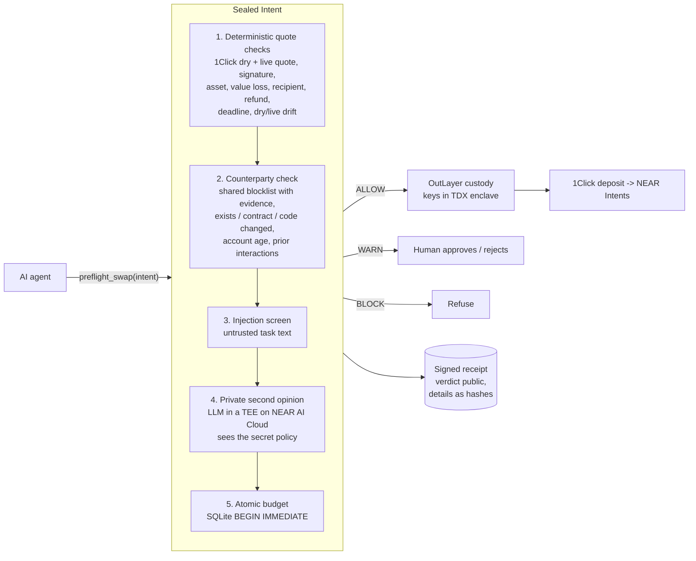

<p align="center"></p>

# Sealed Intent (SeIn)

**A private preflight checker that sits between an AI agent and its money on NEAR.**
The agent can *ask* to swap or pay. Only Sealed Intent can let it happen, and only after checking
what the money will actually do, who receives it, and whether the instruction came from an attacker.
Every decision produces a signed receipt that anyone can verify, without revealing amounts or recipients.

Live site: https://sein-near.vercel.app (overview, Arena replay, receipt verifier). Built at NEAR HACKATHON (Nov 2026). Tracks: `security` (main), `privacy`, `agents`, `defi`.

> **Status:** working offline MVP (no keys, no funds). Of the live path, real 1Click dry quotes and real
> NEAR AI Cloud attestation verification have been exercised; OutLayer execution and a mainnet swap have not yet.
> See [Limits](#limits-read-this).

---

## Try it in 60 seconds

Requirements: Node.js **22.13+** and pnpm (`corepack enable`).

```bash
pnpm install
pnpm demo        # the whole story, offline
pnpm test        # 52 tests, including an 8-process race on the budget
pnpm redteam     # 20 attack scenarios -> out/redteam-report.md
pnpm verify out/receipts
```

### Do X -> see Y

| Do | See |
|---|---|
| `pnpm demo` | A prompt-injected agent tries to pay `drainer-9f3a.near` -> `BLOCK (COUNTERPARTY_BLOCKLISTED, PROMPT_INJECTION_SUSPECTED, TEE_SIGNAL_BLOCK)` -> `[wallet] refusing to sign. Nothing left the wallet.` |
| `pnpm demo` (section 3) | A 3-day-old, never-paid account -> `WARN` -> a human approves; a contract whose code changed -> `WARN` -> human rejects, budget released |
| `pnpm redteam` | Table of 20 scenarios, `Score 20/20`, including a hidden AddKey, a forced freeze, an agent that rotates its id, and: *Sealed Intent spent $90 (cap $100). A read-then-write counter let 10/10 through = $150.* |
| `pnpm verify out/receipts` | One `VALID` line per receipt, with verdict and reason codes |
| `pnpm verify <receipt> --disclose out/disclosures/<id>.recipient.json` | Only the recipient is revealed, and it is proven to match the receipt |
| Edit `"verdict"` in any receipt, then `pnpm verify` it | `INVALID ... issuer signature invalid` |
| `pnpm rest` then `curl -X POST localhost:8787/v1/preflight -H 'Content-Type: application/json' -d @examples/intent.json` | JSON decision (`ALLOW` / `WARN` / `BLOCK`). Approving a WARN needs the owner token printed at startup |
| `pnpm mcp` | MCP server with tools `preflight_swap`, `preflight_transfer`, `preflight_call`, `execute_swap`, `report_counterparty`, `get_receipt`. The agent's name comes from `SEALED_AGENT_ID`, never from the agent |

---

## The problem

AI agents now hold money. On NEAR this year:

- **Binance, 29 Oct 2026: about $6.3B.** A breached request path sent well-formed withdrawals, and the signer signed them because the format was valid (per public reporting; no post-mortem yet).
- **Grok and Bankr, May 2026: about $150K-200K reported.** A prompt hidden in a message made an agent relay a transfer.
- **Aave/CoW, Mar 2026: $50M became about $36K.** The slippage floor came from the bad quote itself, so the check passed.
- An OpenAI research agent **used a funded testnet wallet it was not entitled to** for fees, then left it out of its report (Fortune, 16 Oct 2026).

Signers check format. Sealed Intent checks meaning. A spending limit alone does not know that the token is a
look-alike, that the route returns 30% less than a reference price, that the quote was edited after it was signed,
that a "transfer" also adds a key, or that the instruction came from an email that said *"ignore previous instructions"*.
None of this would have stopped the incidents above as they happened to their actual victims; the patterns are what we test.

## What Sealed Intent checks



**The LLM is a signal, not the judge.** Verdicts come from deterministic rules. The TEE opinion can only make a verdict stricter.

| Layer | Blocks | Example reason codes |
|---|---|---|
| Quote integrity | quote edited after 1Click signed it; quote service paying someone else; asset/amount/recipient/refund differs from what the agent declared | `AGENT_QUOTE_FORGED`, `QUOTE_RECIPIENT_MISMATCH`, `QUOTE_ASSET_MISMATCH` |
| Asset | look-alike tokens (same symbol, different contract), unknown assets | `LOOKALIKE_ASSET`, `ASSET_NOT_ALLOWED` |
| Value | route returns too little vs the reference price in 1Click's token list (same source as the quote: a second price source is on the roadmap); live quote worse than the dry quote that was checked | `EXCESSIVE_VALUE_LOSS`, `DRY_LIVE_DRIFT` |
| Action class | anything that is not a swap, transfer or allow-listed contract call: adding keys, deploying code, signing messages for intents.near, deleting the account. These block **and freeze the wallet** | `ACTION_CLASS_FORBIDDEN`, `METHOD_NOT_ALLOWED`, `WALLET_FROZEN` |
| Counterparty | blocklisted (with evidence), non-existent, brand-new, first contact, contract code changed | `COUNTERPARTY_BLOCKLISTED`, `COUNTERPARTY_NOT_FOUND`, `COUNTERPARTY_CODE_CHANGED` (WARN) |
| Instruction | prompt injection in the task text (heuristics + TEE opinion) | `PROMPT_INJECTION_SUSPECTED`, `TEE_SIGNAL_BLOCK` |
| Money | per-tx cap; hourly/daily caps that hold under parallel requests | `ABOVE_PER_TX_LIMIT`, `HOURLY_BUDGET_EXCEEDED` |
| Privacy | payroll and other sensitive purposes forced through Confidential Intents | `ROUTE_NOT_CONFIDENTIAL` |

### Three verdicts

- **ALLOW**: executed through the custody enclave.
- **WARN**: budget is reserved, but nothing is signed until a **human** approves (`POST /v1/approve`, or the `HumanApprover` callback in `SealedWallet`). There is deliberately no MCP tool for approving, so the agent cannot approve itself.
- **BLOCK**: the agent-side `SealedWallet` refuses to sign.

### Why the policy is secret

The agent only sees a verdict and generic codes, never thresholds. This raises the cost of probing for a limit;
it does not prevent it, since ALLOW/BLOCK answers still leak one bit per request (rate limiting and probe detection
are on the roadmap). The policy is stored encrypted (AES-256-GCM, `pnpm policy:seal`), and each receipt carries a
commitment to the exact policy that was applied.

### Identity, approval and the kill switch

- The agent's identity is assigned by the server: a bearer token maps to an agent name (`SEALED_AGENT_TOKENS`), and the budget is counted per that name. Whatever the agent writes in the request body is ignored.
- Approving or rejecting a WARN, freezing and unfreezing need the **owner token** (`SEALED_OWNER_TOKEN`), which the agent never holds. Pending decisions live in SQLite, so a WARN raised through MCP can be approved through REST.
- A forbidden action class, or 20 BLOCKs within an hour, freezes the wallet until the owner lifts it (`POST /v1/unfreeze`). The freeze survives restarts.
- The budget is only given back when the executor reports that nothing left the wallet; an unclear outcome counts as spent.

---

## Privacy: what is hidden, what is proven

| Data | Where it goes |
|---|---|
| Verdict, reason codes, route, mode, quote correlation id | **Public receipt** (signed ed25519) |
| Agent id, tokens, amounts, minAmountOut, recipient, refund, deposit address, task text | Public receipt holds only **salted SHA-256 commitments**. Values and salts stay in `.sealed/openings` with the owner |
| One field for one auditor | `pnpm disclose <receiptId> recipient` -> `pnpm verify <receipt> --disclose <file>` |
| Secret policy | Encrypted at rest; sent only to the TEE; the receipt holds a commitment |
| TEE request/response | **Not stored.** Only `sha256(request bytes)`, `sha256(response bytes)` and the enclave signature go into the receipt |
| Payment route | `confidentiality: basic/advanced` on the 1Click quote when the policy says so (Confidential Intents) |

**TEE evidence (live mode).** Before the secret policy is sent anywhere, Sealed Intent fetches a NEAR AI Cloud
attestation report with a fresh 32-byte nonce and verifies, on your machine:
1. the Intel TDX quote of the gateway and of every model report, against Intel collateral (`@phala/dcap-qvl`), with the TCB status your policy accepts and debug mode off;
2. that the verified quote's report data binds our nonce and the signing address;
3. that the measured configuration matches MRCONFIGID and the event log replays to RTMR3;
4. the NVIDIA GPU evidence through NVIDIA's attestation service (NRAS), nonce included.

Only then is the prompt sent. The receipt id is inside the signed request, so the enclave's signature names this
decision. After the completion, the response signature must be `provider_tee` and its signer must match exactly one
verified model report; `pnpm verify` re-checks the signature offline and refuses real evidence that is not bound.
Not covered: binding the TLS connection to the gateway attestation (see Limits).

---

## NEAR components used, and why

| Component | Used for |
|---|---|
| **NEAR Intents / 1Click API** | Dry and live quotes; quote signatures verified with the official SDK `verifyQuoteSignature` (ed25519, 1Click manager key); `confidentiality` for private routes; `/v0/deposit/submit` after execution |
| **NEAR AI Cloud** | Private policy check inside a TEE: OpenAI-compatible API, `/v1/attestation/report`, `/v1/signature/{id}` |
| **OutLayer Agent Custody** | Keys live in a TDX enclave; the agent never holds them. OutLayer's own policy is a second layer |
| **NEAR RPC** | `view_account` (exists, contract, code hash) and `storage_balance_of` before a deposit |
| **Confidential Intents** | Route for sensitive purposes (payroll) |

### Why custody, and what a function-call key can and cannot do

The security track suggests function-call access keys. We use them where they fit, and explain where they do not:

- A **function-call key** can call only the methods of one contract that you list, with **no attached deposit** and a limited gas allowance. It cannot transfer NEAR, cannot add keys, and an account holding only such keys can lock itself out if the allowance runs out. We confirmed this on a local NEAR node: `ft_transfer` with 1 yoctoNEAR under such a key is rejected by the protocol (`DepositWithFunctionCall`), and without the deposit the token contract rejects it.
- Paying with a NEP-141 token needs `ft_transfer` with **1 yoctoNEAR attached**, so a function-call key cannot pay *directly*. Today the key that moves money is held in OutLayer's enclave and reachable only through Sealed Intent's ALLOW path. A guard contract that holds the tokens and checks a Sealed Intent authorization on chain would let the agent hold only a function-call key (roadmap).
- Function-call keys *are* the right tool for zero-deposit calls such as anchoring receipt hashes on chain (roadmap).

---

## How this differs from what already exists

| | Spending caps | Recipient allow-list | Checks quote meaning (token, value, signature, drift) | Counterparty signals | Injection + private TEE opinion | Secret policy | Verifiable private receipts |
|---|---|---|---|---|---|---|---|
| **NEAR Intents Agent API** (official) | ✅ atomic | ✅ | ❌ | ❌ | ❌ | owner-signed, readable via `GET /policy` | ❌ |
| **OutLayer custody policy** | ✅ (cumulative caps can be exceeded by concurrent requests, per its docs) | ✅ | ❌ | ❌ | ❌ | ✅ encrypted | ❌ |
| **NEAR Intents SHIELD** (official, protocol level) | — | — | incident-based quote evaluation: allow or delay | ❌ | ❌ | — | ❌ |
| near-agent-guard, nearvault (hackathon repos) | ✅ | ✅ | ❌ | ❌ | ❌ | ❌ | audit log |
| Centaurion (X Layer) | partial | ✅ | tx simulation (EVM) | partial | ❌ | ❌ | partial |
| **Sealed Intent** | ✅ atomic across processes | ✅ + WARN tier | ✅ | ✅ | ✅ | ✅ | ✅ |

Sealed Intent is designed to sit **in front of** the Agent API or OutLayer, not to replace them.
The Agent API docs note that native requests (for example `native.near.transfer`) bypass its destinations,
budget and owner approval. A pre-signing layer that every request goes through closes that gap.
SHIELD screens quotes at the protocol level; Sealed Intent protects an agent's owner from the agent.

---

## Live mode (mainnet)

```bash
cp .env.example .env              # fill NEARAI_API_KEY, NEARAI_MODEL, OUTLAYER_API_KEY, SEALED_AGENT_TOKENS, SEALED_OWNER_TOKEN
pnpm policy:seal fixtures/policy.example.json   # prints a SEALED_POLICY_KEY the first time; put it in .env
pnpm demo --live --usd 1          # preflight only
pnpm demo --live --usd 1 --yes    # preflight + execute through OutLayer custody
SEALED_MODE=live pnpm rest        # REST in live mode (binds 127.0.0.1); set SEALED_AGENT_TOKENS and SEALED_OWNER_TOKEN
```

NEAR Intents has no testnet. Use a separate dev account and tiny amounts. Live mode refuses to start without `OUTLAYER_API_KEY` (set `SEALED_ALLOW_SIMULATED_EXECUTOR=1` for a preflight-only run), and the example policy requires a verified TEE opinion.

## The Arena: incident patterns replayed against three wallets

Three identical scripted agents receive the same everyday tasks and the same attacks. One holds its own key
(no guard), one has spending caps only (what most agent wallets ship), one goes through Sealed Intent. A referee
that only reads balances, keys and code hashes keeps score; it never reads a verdict, so the checker cannot grade itself.
Every scenario follows the pattern of a real incident (Grok/Bankr, Aave/CoW, Binance, Kiln, DSProxy, Permit, Morse,
NEAR-native cases) with a source link; what could not be replicated is stated per scenario.

```bash
pnpm arena:run                      # in-memory ledger with NEP-141 rules, 14 mandatory scenarios, seconds
pnpm arena:run --all                # the whole catalog (17)
pnpm arena:run --chain sandbox      # the same world on a real local NEAR node (near-sandbox; Linux or macOS)
pnpm arena:verify official          # re-check the manifest signature and recompute the referee from recorded balances
```

Official recording (`replays/official`, ledger, strict owner): no guard lost $1,502.78 to 13 of 14 attacks, caps only
$652.78 to 11, Sealed Intent $235.00 to 5. All three finished 84 of 84 legitimate tasks. The five that get through
Sealed Intent are by design: a stolen key, a forged verdict accepted by the signer, a compromised checker host, a
lying RPC, and a token-contract bug. They are shown, not hidden. Test tokens only; quotes, the enclave opinion and
custody are simulated stand-ins; the rules are the real code. The web replay is at https://sein-near.vercel.app/arena.html.

A second recording, `replays/official-sandbox`, is the same 14 scenarios run on three real local NEAR nodes
(`--chain sandbox`, nearcore 2.13.4). Its scoreboard is identical to the ledger run, line for line, and it verifies
the same way (`pnpm arena:verify official-sandbox`). The web replay has a selector for either recording.

The `--chain sandbox` adapter (`packages/arena/src/sandbox.ts`) deploys genuine wrap.near bytecode as the four
tokens, creates every account under the sandbox root, and runs each scenario from a restored snapshot. The swap router
and account age are simulated there; everything else is the node's own behaviour. `SEALED_SANDBOX_TESTS=1 pnpm test`
runs a parity test that compares the referee's verdicts between ledger and sandbox.

## Project layout

```
packages/core       preflight engine, 1Click client, checks, counterparty, budget, TEE client, executors, SealedWallet
packages/receipt    canonical JSON, commitments, ed25519 receipts, EIP-191 / TEE evidence check, verify + disclose CLIs
packages/redteam    20 attack scenarios + report
packages/arena      three-lane simulation: ledger and near-sandbox chains, incident catalog, referee, signed recordings
apps/web            public site: overview, Arena replay, in-browser receipt verifier (Vite, static)
apps/server         REST and MCP servers
scripts             demo, policy sealing
fixtures            example policy (offline fixtures live in packages/core/src/fixtures.ts)
```

## Limits (read this)

- **Offline mode is a simulation.** Fixture quotes are signed with a local "manager" key and checked by the *same* SDK function used in live mode. The enclave is simulated and every receipt says `offline-simulated`.
- **TLS connection binding is not implemented.** The Intel and NVIDIA evidence is verified locally, but a proxy that relays genuine reports could still read the prompt. Collateral for the Intel check comes from Phala's PCCS unless `SEALED_PCCS_URL` points at Intel. The NVIDIA token is accepted on NRAS's TLS, not validated locally.
- **The Sealed Intent process itself is a trust point.** If the host running it is compromised, the checks are bypassed. Run it on a machine the agent cannot reach; the MCP transport is stdio today, so put it behind a thin proxy or use REST from another host. A guard contract on chain is the roadmap answer.
- **Only swaps are quoted.** Transfers and contract calls are checked against the policy and priced from the token list, with no 1Click quote.
- **NEAR AI Cloud signatures** prove a response came from an attested signing key, not which instance produced it, since instances share keys. Confidential Intents hides the origin and route, not the amount or recipient on the destination chain.
- **Account age** needs an indexer (FastNEAR / NearBlocks). RPC does not provide it. In live mode the signal is skipped when unavailable.
- The heuristic injection screen is a first filter. The deterministic checks are what actually stop the money.
- Live execution currently supports NEP-141 origin assets on NEAR.
- **Blocklist reports are self-asserted.** Any authenticated agent can add an entry with "evidence"; treat the shared list as a signal, not a verdict.
- Not audited. Do not use with funds you cannot lose.

## Roadmap

Anchor receipt hashes on chain with a function-call key · Trezu / Sputnik DAO multisig for WARNs above a threshold ·
Agent API executor adapter · local DCAP verification · indexer-backed account age · shared blocklist as a signed feed between instances · pay-per-check for other agents.

## Pre-hackathon code and attribution

Hackathon rules count work from the announcement on 19 Oct 2026. This repository was started on 1 Nov 2026.
It uses the official `@defuse-protocol/one-click-sdk-typescript` (quote signature verification) and
`@modelcontextprotocol/sdk`. No code was copied from the author's earlier projects.

## License

MIT
